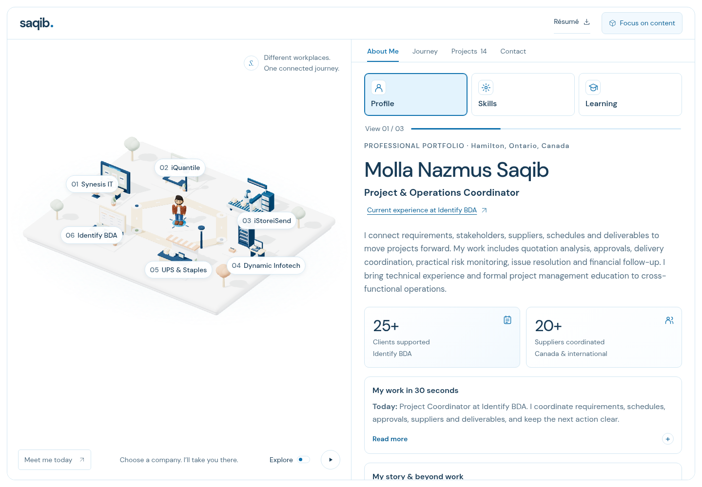

# Molla Nazmus Saqib — Project & Operations Coordinator

A white and sky-blue portfolio built with Vite, JavaScript, and Three.js. The opening professional overview connects current coordination experience, the approved résumé, contact details, and a conference case study. Personal stories and the six-workplace journey remain available for deeper exploration.



## Development

Use Node.js 22.12+ and the existing checkout at `/workspace/Portfolio` in the prepared cloud environment. Setup was verified with Node.js 24.19.0 and npm 11.9.0.

```sh
npm ci --no-audit --no-fund
npm run dev -- --port 5173 --strictPort
```

Fonts, illustrations, project images and the character are bundled or generated locally. The application needs no backend, API key or external asset service. Keep uploaded source documents and confidential records outside `public/` and `dist/`.

## Build, test and publish

The public project site is https://nazmus-saqib.github.io/Portfolio/.

```sh
npm run build -- --base=/Portfolio/
npm run preview -- --base=/Portfolio/ --port 4174 --strictPort
PORTFOLIO_TEST_URL=http://127.0.0.1:4174/Portfolio/ npm test
```

Playwright uses `/usr/bin/chromium`, or `CHROMIUM_PATH` when supplied. The preview server must run in a separate session. A quick deployment-path check is `npm test -- tests/pages.spec.js` with the same `PORTFOLIO_TEST_URL`.

`main` contains editable source. `gh-pages` contains a tested copy of `dist/`, `.nojekyll`, and any existing `CNAME`. GitHub Pages deploys from that branch's root. Building or pushing alone does not establish that the public deployment succeeded; check the deployment and public assets separately.

## Navigation and accessibility

- About Me opens at the centre of the world. Its Profile, Skills and Learning tabs include the professional overview, always-visible skill cards, qualifications, and optional personal story.
- Journey starts with Identify BDA and goes backwards through UPS & Staples, Dynamic Infotech, iStoreiSend, iQuantile and Synesis IT. The original company numbers remain: 06 Identify BDA through 01 Synesis IT. Map keyboard order and Reading View follow the current-to-previous sequence. Overlapping roles remain labelled, and workplace locations on the map stay fixed.
- The world footer shows “Choose a company. I’ll take you there.” between the email action and Explore controls, wrapping above them in compact scenes. Explore mode shows movement guidance instead.
- Meet me today and Start a conversation open the same email chooser, with Gmail and Outlook compose links, an email-app link and a copy-address option. The webmail options work without a configured desktop mail handler. Closing the chooser restores the selected panel, Journey stop and keyboard focus. Current experience at Identify BDA remains available from the professional overview.
- Projects opens with Operations: three documented project examples, two recurring coordination methods and a separate role overview. Earlier digital work is available through its own filter. Case-study research, ownership, source notes and templates remain visible; image and portal galleries retain their navigation.
- Each project has a shareable `?project=id` URL, such as `?project=conference`, with browser history support.
- Focus on Content uses the reading view to preserve the selected section and its content. Journey expands into all six employer chapters in that view.
- On phones, the professional overview takes priority; visitors choose when to open the 3D journey. Desktop gives the interactive world and professional content roughly equal width. Reduced motion, pause, keyboard navigation and a no-WebGL alternative remain available.
- The résumé stays explicitly labelled on phones. Delivered HTML also provides professional and project summaries with working résumé and email links when JavaScript is disabled.

## Content and source files

- `src/content.js`: career history, project collection, qualifications and skills.
- `src/coordination-case-studies.js`: current conference, supplier and issue-coordination case content and template data.
- `src/main.js`: navigation, dialog URLs, reading mode and scene startup.
- `src/recruiter-view.js`: concise professional overview and expandable personal previews, with four target roles listed in Contact. Résumé and Contact remain accessible through the main navigation.
- `src/project-view.js` and `src/coordination-case-view.js`: digital and coordination case presentation.
- `src/case-study-sections.js`: original project pictures and interactive supporting studies.
- `src/profile-view.js`, `src/story-view.js`, `src/contribution-view.js` and `src/workflow-view.js`: profile, personal journey and employer details.
- `src/world.js` and `src/character.js`: locally generated career world and the brown-jacket character.
- `public/projects/`: optimized project previews; original Signfy personas and the owner-supplied eReturn sketches and inspiration board remain intact.
- `public/Molla_Nazmus_Saqib_Project_Coordinator_Resume.pdf`: owner-approved PDF, retained unchanged. `public/resume.html` works without JavaScript.
- `public/social-preview.png`: screenshot of the portfolio used for social sharing.
- `docs/audit-validation.md`: validation evidence and the pending three-person comprehension study.

The primary email matches the approved résumé. Project tools are grouped by their practical use and remain listed in the relevant work examples and case studies. The broad professional headline and the Identify employment title are deliberately distinct. Counts use supported client and supplier figures. No unverified monthly project count, invented savings or research outcomes are presented. Earlier design projects retain their original individual, team or academic context, and reconstructed supporting studies remain labelled.

`package-lock.json` pins dependencies. See [third-party notices](THIRD_PARTY_NOTICES.md) for bundled font and library licenses.
