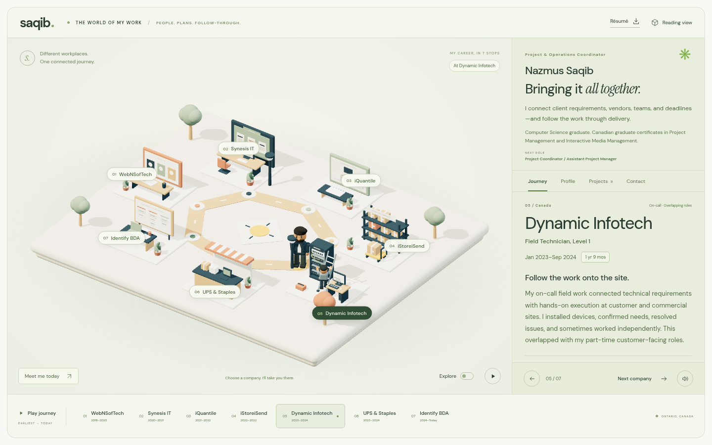

# Nazmus Saqib — A world of connected work

A responsive portfolio about project and operations coordination, built with Vite, vanilla JavaScript, and Three.js. The miniature 3D world connects four career chapters; the site opens on the current Identify BDA role. Earlier UX work appears as career history, alongside individual, team, and academic project stories.



## Run locally

Use Node.js 22.12+ (validated here on Node.js 24.19.0).

```sh
git clone https://github.com/nazmus-saqib/Portfolio.git
cd Portfolio
npm ci
npm run dev
```

In the prepared cloud environment, use the existing checkout at `/workspace/Portfolio`.

Build a static site and serve the output:

```sh
npm run build
npm run preview -- --port 4173
```

Deploy the generated `dist/` directory to a static hosting provider. No API keys, account integrations, backend, or external asset services are required. Fonts, images, models, and JavaScript are bundled locally. Building alone does not publish the website.

### GitHub Pages

The project-site address is `https://nazmus-saqib.github.io/Portfolio/`. Build for its project path:

```sh
npm run build -- --base=/Portfolio/
```

The `gh-pages` branch contains the compiled website, including fonts, project images, résumé, license notices, and a `.nojekyll` marker. In the repository's **Settings → Pages**, select **Deploy from a branch**, choose **gh-pages**, select **/ (root)**, and save. GitHub publishes the branch after Pages is enabled. Subsequent source changes need a fresh build and an update to that deployment branch. The `main` branch retains the editable source.

For a local Pages-path regression check, serve the build with `npm run preview -- --base=/Portfolio/ --port 4174 --strictPort`, then run `PORTFOLIO_TEST_URL=http://127.0.0.1:4174/Portfolio/ npm test -- tests/pages.spec.js`.

## Controls and alternatives

- Choose a chapter or a place in the 3D world to move the character and read its story.
- “Explore freely” enables WASD / arrow-key movement while the canvas has keyboard focus; on-screen controls support touch.
- The speaker button starts optional narration using the visitor’s browser speech synthesis. Voice availability depends on the browser/device. No voice recording is embedded.
- Pause stops scene animation. Reduced-motion preferences disable continuous movement.
- “Switch to reading view” presents all four chapters as ordinary text. If WebGL is unavailable, a fallback leads to this view.
- Current operations and earlier digital-work filters, expandable project stories, a BIWTA prototype gallery, education, experience, and course credentials work independently of the 3D scene.

## Content and personalization

- `src/content.js`: career chapters, project stories, skills, education, and credentials.
- `src/main.js`: interface and interactions; public contact email.
- `src/world.js`: locally generated character and environment; no external model downloads.
- `src/styles.css`: responsive interface styling.
- `public/projects/`: optimized previews from supplied project files. Original career records, project source files, and confidential documents are **not** public assets.
- `public/favicon.svg`: the site icon. The wordmark is styled in CSS, interface icons are inline SVG in `src/main.js`, and illustrative project covers are generated from HTML/CSS. No external icon account or asset download is required.
- `public/licenses/`: original dependency license notices, also copied into the built website.
- `public/resume.html` and `public/nazmus-saqib-resume.pdf`: a reviewable two-page résumé based on the supplied career record. To revise the résumé, edit the HTML and print to Letter PDF with background graphics enabled, no browser header/footer, and zero margins (page padding is defined in the document).

`package-lock.json` pins all library and font dependencies. Run `npm ci` to restore them; dependency folders and build output are not committed. The production build includes the used font files, images, CSS, and scripts. See [third-party notices](THIRD_PARTY_NOTICES.md) for bundled font and library licenses.

The character is a provisional stylized representation inspired by the previously supplied training-poster photo. A recent photo had not arrived as an accessible attachment at implementation time. ODIN, Quantibly, and Cozey use clearly labeled portfolio cover illustrations because their original source files exceeded the transfer limit. Confidential Quantibly system details remain excluded. Signfy is presented as an academic concept/prototype; its planned business targets are not represented as achieved results. Project dates beyond known employment periods are not invented. Education completion dates were not supplied and are omitted.

## Browser validation

```sh
npm run build
npm test
```

The Playwright configuration uses Chromium at `/usr/bin/chromium` in this cloud environment (or `CHROMIUM_PATH` if provided). In another environment, install a compatible browser or set that path. Tests cover chapter navigation, real canvas movement, reading view, project filtering and dialogs, local images and résumé download, mobile layout, reduced motion, and the no-WebGL fallback. Test reports and generated build files are ignored by Git.

Use the existing checkout; cloud tasks are already isolated. Do not create worktrees unless explicitly requested.
